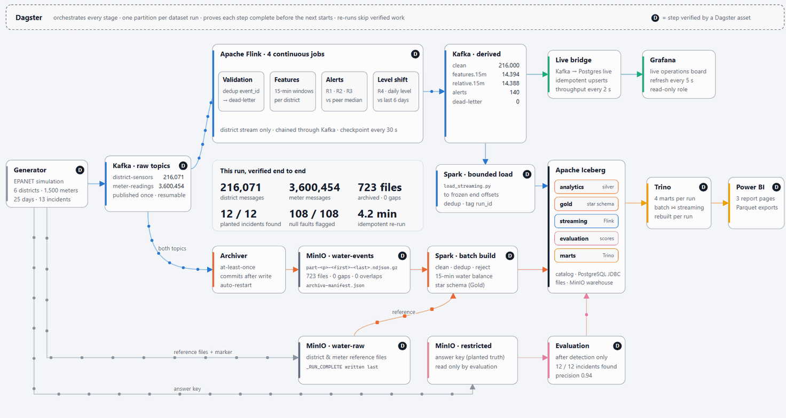

# Egypt Water Intelligence

A **simulated** water-distribution analytics platform. A hydraulic simulator generates 25 days of sensor and meter
data for six districts, with planted incidents (bursts, leaks, supply failures, demand surges) and injected data
faults. The pipeline streams it through Kafka, detects incidents in real time with Flink, archives every event to
MinIO, builds verified analytical tables with Spark in Apache Iceberg, joins both paths in Trino, and is orchestrated
end to end by Dagster. All results are simulated, not real utility measurements.

```
Generator → Kafka ─┬→ Archiver → MinIO → Spark batch ─┐
                   └→ Flink → Kafka ─→ Spark load ─────┴→ Iceberg → Trino → dashboards
                                     └→ live bridge → Grafana (live)
```



For the interactive version (click any component, step-by-step tour, presentation mode), open
[docs/pipeline-diagram.html](docs/pipeline-diagram.html) in a browser.

## Quick start (Windows PowerShell)

```powershell
.\run.ps1 setup      # once: build images, install Dagster
.\run.ps1 up         # start the services
.\run.ps1 dagster    # Dagster UI on http://localhost:3000 (keep open)
.\run.ps1 pipeline   # in a second window: run every stage
```

Details, timings and troubleshooting: [docs/RUNNING.md](docs/RUNNING.md).

## Repository map

| Folder | Content |
|---|---|
| `Generator/` | simulation, publisher, Kafka→MinIO archiver, validator |
| `flink/` | the four Flink detection jobs, their scripts, analysis and evaluation tools |
| `batch/` | Spark jobs: batch build and validation, streaming load into Iceberg, dashboard export |
| `orchestration/` | the Dagster project |
| `live/` | live bridge from Flink's topics to Postgres for Grafana |
| `infrastructure/` | Iceberg catalog schema, Trino catalog and marts, Grafana provisioning |
| `configs/` | dataset configurations for the pipeline and the live demo |
| `docs/` | documentation; start with [docs/README.md](docs/README.md) |
