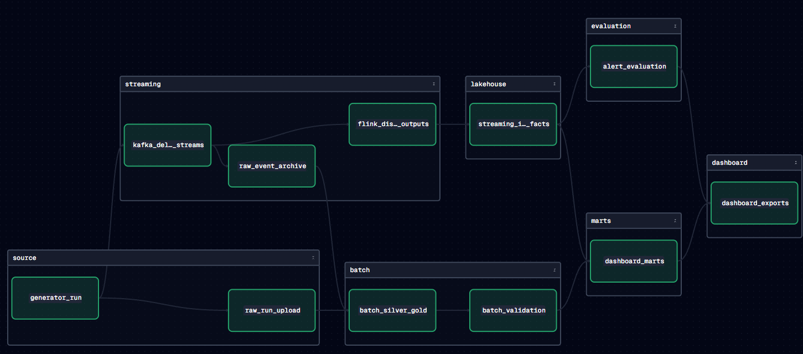

# 1. What this project is, in one read

Egypt Water Intelligence is a **simulated** water-distribution analytics platform. Nothing here is real utility
data: a hydraulic simulator (EPANET) generates 25 days of measurements for a small water network, deliberately
plants problems in it (bursts, leaks, supply failures, demand surges) and deliberately damages some of the data
(missing values, duplicate messages). The rest of the project is a data platform that tries to **find those
problems** and **survive that damaged data**, the way a real utility's platform would have to.

The point of the project is the engineering: getting data from a source into analytics **reliably**, in two ways
at once (real-time and batch), with every step checked and repeatable.

## The story of one run, start to finish

1. **Generate.** The generator simulates 6 districts and 1,500 water meters for 25 days. It writes clean files,
   "delivery" files (the clean data plus injected faults), and a sealed answer key (which incidents were planted
   where) that only the final evaluation may read.
2. **Stream.** The delivery events are published into **Kafka**, the message bus, as two live streams:
   district sensors (one reading per district per minute) and household meters (one reading per meter per 15
   minutes). About 3.8 million messages.
3. **Archive.** An **archiver** listens to both streams and writes every message, unchanged, into **MinIO**
   (an S3-compatible object store). This is the permanent raw record.
4. **Detect in real time.** **Flink** listens to the district stream at the same time. It cleans it, builds
   15-minute summaries, compares each district with the others, and raises **alerts** within about 30 minutes of
   an incident starting.
5. **Process in batch.** Once the archive is *proven* complete, **Spark** reads it and builds clean, validated
   analytical tables: a water balance (water that entered a district vs water its customers' meters recorded),
   facts, dimensions and data-quality tables. They are stored as **Apache Iceberg** tables in MinIO.
6. **Bring the streaming results into the lakehouse.** Spark also copies Flink's results (alerts, 15-minute
   features) into Iceberg, so both paths can be queried together.
7. **Query and explain.** **Trino** (a SQL engine) builds reporting tables ("marts") that combine both paths, e.g.
   *"for every incident Flink detected, did the meters show lost water or higher demand?"*
8. **Evaluate.** Only now is the answer key opened, to measure how many planted incidents were found.
9. **Show.** A **Grafana** board shows detections live while data streams; a **Power BI** dashboard shows the
   analytical results.

**Dagster** orchestrates steps 1–8: it runs them in the right order, proves each one finished correctly, records
everything, and makes re-running safe.

*The Dagster asset graph after a complete run. Each box is one stage; the arrows are real data dependencies.
Green means "done and verified" for this run.*

## The tools and what each one is for

| Tool | Role in this project | Where to see it |
|---|---|---|
| EPANET / WNTR (Python) | Hydraulic simulation inside the generator | `Generator/` |
| Kafka | Message bus carrying the two event streams | Kafka UI, http://localhost:8080 |
| Archiver | Copies every Kafka message into MinIO, unchanged | MinIO `water-events` bucket |
| MinIO | Object storage: raw files, the Kafka archive, and the Iceberg tables' files | http://localhost:9001 |
| Flink (PyFlink) | Real-time cleaning, 15-minute features, incident detection | http://localhost:8081 |
| Spark (PySpark) | Batch cleaning, water balance, Gold tables; loads Flink results into Iceberg | Spark UI http://localhost:4040 (while a job runs), history http://localhost:18080 |
| Apache Iceberg | Table format for every analytical table (versioned, transactional files in MinIO) | through Trino |
| PostgreSQL | The Iceberg **catalog**: the list of tables and where their current metadata lives | internal |
| Trino | SQL over the Iceberg tables; builds the marts | http://localhost:8082 |
| Dagster | Orchestration, verification, lineage and run history | http://localhost:3000 |
| Grafana + live bridge | Live operations board fed straight from Flink's outputs | http://localhost:3001 |
| Power BI | Analytical dashboard (built locally, not stored in the repository) | Power BI Desktop |

## The dataset we run

| Property | Value |
|---|---|
| Configuration | `configs/pipeline-large.yml` |
| Run ID | `run-72b96af88a342375` (derived from the configuration, so the same config always gives the same run) |
| Network | 6 districts, 1,500 meters (250 per district), 25 days from 2026-01-01 UTC |
| District sensor events | 216,000 clean, 216,071 delivered (71 duplicates injected) |
| Meter events | 3,600,000 clean, 3,600,454 delivered (454 duplicates injected) |
| Injected nulls | 108 missing district pressures, 720 missing meter volumes |
| Planted incidents | 13 (bursts, gradual leaks, supply disturbances, demand surges, persistent losses) |

There is also a small `configs/demo-live.yml` (2 days, 180 meters) used only for the live demo replay.

## How to read the rest

| Document | Read it to understand |
|---|---|
| [2. Architecture](02-architecture.md) | How the pieces connect, where every piece of data lives |
| [3. Orchestration with Dagster](03-orchestration.md) | Every Dagster step, what it checks, why re-running is safe |
| [4. Streaming path](04-streaming.md) | Kafka, the archiver, Flink, how Flink's results reach Iceberg, the live board |
| [5. Batch path](05-batch.md) | The Spark job, how incremental processing works, every edit we made to it |
| [6. Lakehouse, marts and results](06-lakehouse-and-results.md) | Iceberg, Trino, the marts, the dashboards and what the numbers say |
| [7. Design decisions](07-design-decisions.md) | The problems we hit, the decision each forced, and what makes this pipeline different |
| [8. What we changed](08-what-we-changed.md) | File-by-file: what came from teammates, what I added or edited |
| [Running the system](RUNNING.md) | Start to finish, with the commands |
