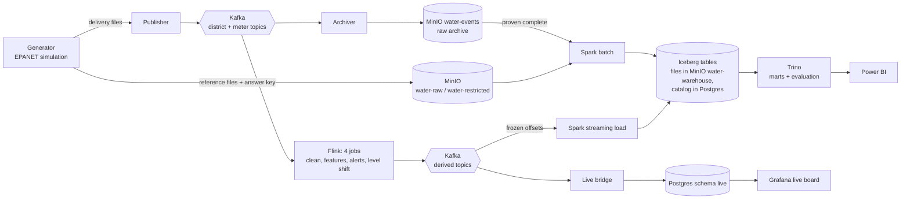
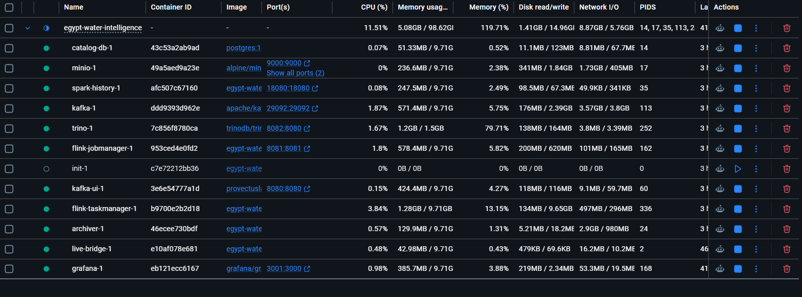
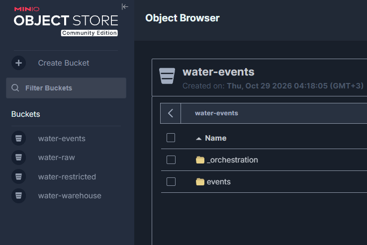

# 2. Architecture: how the pieces connect

## The data flow

Two paths leave Kafka:

- **The streaming path** (Flink) answers *"is something wrong right now?"* within about 30 minutes of an incident,
  using district sensors only.
- **The batch path** (Spark) answers *"what exactly happened, with complete and verified data?"*. It is the only
  path that uses the household meters, because it can wait for complete data.

They meet again in Trino, where the marts combine them. That combination is the most valuable result of the
project (see [6. Lakehouse, marts and results](06-lakehouse-and-results.md)).

## What runs all the time and what runs per run

| Kind | Components | Started by |
|---|---|---|
| Always-on services | Kafka, MinIO, Kafka UI, archiver, Flink JobManager + TaskManager, Postgres (catalog), Trino, Spark History, live bridge, Grafana | `docker compose up -d` |
| Always-on streaming jobs | The four Flink jobs (`ewi-validation`, `ewi-features`, `ewi-alerts`, `ewi-level_shift`) | Dagster submits them once, before the first publication |
| Finite steps, per run | generation, validation, upload, publication, verification, Spark jobs, marts, exports | Dagster |

`docker compose up` only starts infrastructure. It never generates or publishes data. Dagster is the only thing
that moves data, so every movement is recorded.

*Docker Desktop with the whole stack running: 12 services, about 5 GB of memory in total.*

## Where every piece of data lives

### Kafka topics

| Topic | Written by | Content |
|---|---|---|
| `water.district-sensors.v1` | publisher | one message per district per minute (raw, with injected faults) |
| `water.meter-readings.v1` | publisher | one message per meter per 15 minutes (raw, with injected faults) |
| `water.district-sensors.clean.v1` | Flink job 2 | validated, deduplicated district readings |
| `water.dead-letter.district.v1` | Flink job 2 | readings rejected as malformed (empty for this dataset) |
| `water.district-features.15m.v1` | Flink job 3a | 15-minute summaries per district |
| `water.district-relative.15m.v1` | Flink job 3b | each district's flow relative to the other five |
| `water.district-alerts.v1` | Flink jobs 3b + 3c | incident and data-quality alerts |

The live demo uses the same names with a `demo.` prefix, so it never touches these.

### MinIO buckets

| Bucket | What is in it | Who reads it |
|---|---|---|
| `water-raw` | `<run>/artifacts/` (manifest, validation report, district and meter reference lists, network model) and `<run>/_RUN_COMPLETE` | Spark batch (reference data only) |
| `water-restricted` | `<run>/restricted/` (configuration and the answer key: scenario truth, fault truth) | **only** the evaluation step |
| `water-events` | `events/<topic>/<run>/part-<partition>-<first>-<last>.ndjson.gz` (the Kafka archive), `_manifests/<run>/archive-manifest.json` (proof the archive is complete), `_orchestration/stream.json` (which runs were published) | Spark batch (events), Dagster |
| `water-warehouse` | the Iceberg tables' data and metadata files | Spark, Trino |

*The four buckets. `water-events` holds the archive (`events/`) and the orchestration's proof files (`_orchestration/`).*

Event data reaches MinIO **only** through Kafka and the archiver. There is deliberately no second copy of the
events uploaded from the generator's files, so the batch path cannot bypass the streaming infrastructure.

### Iceberg namespaces (catalog `water`)

| Namespace | Owner | Content |
|---|---|---|
| `analytics` | Spark batch | Silver: cleaned events, rejected events, references, 15-minute water balance, quality report, batch manifest |
| `gold` | Spark batch | Gold: dimensions, facts, daily water balance, consumption by customer class, daily data quality |
| `streaming` | Spark streaming load | Flink's alerts, 15-minute windows and dead letters, as tables |
| `evaluation` | Dagster (via Trino) | results of comparing alerts with the answer key |
| `marts` | Trino | reporting tables combining batch and streaming |

Each namespace has exactly one writer, so two engines never commit to the same table at the same time.
Every table is partitioned by `run_id`, so separate generated runs never mix.

### Why Iceberg needs a catalog

An Iceberg table is a set of data files (Parquet) plus metadata files in MinIO. The **catalog** is the small
database that says "table `water.gold.dim_district` currently starts at metadata file X". Spark and Trino read the
same catalog (a PostgreSQL database), which is why a table Spark writes is immediately visible to Trino.

## Ports

| URL | Service |
|---|---|
| http://localhost:3000 | Dagster (started from your terminal, not by Docker) |
| http://localhost:3001 | Grafana live board |
| http://localhost:8080 | Kafka UI |
| http://localhost:8081 | Flink dashboard |
| http://localhost:8082 | Trino UI |
| http://localhost:9001 | MinIO console (user `wateradmin`, password `wateradminsecret`) |
| http://localhost:4040 | Spark UI, only while a Spark job runs |
| http://localhost:18080 | Spark History (finished Spark jobs) |
| `localhost:29092` | Kafka for tools on your machine (containers use `kafka:9092`) |

## Configuration

All settings (passwords, bucket names) have defaults in `docker-compose.yml`. To change them, copy
`.env.example` to `.env`. Dagster reads the same `.env`, so there is only one configuration.
