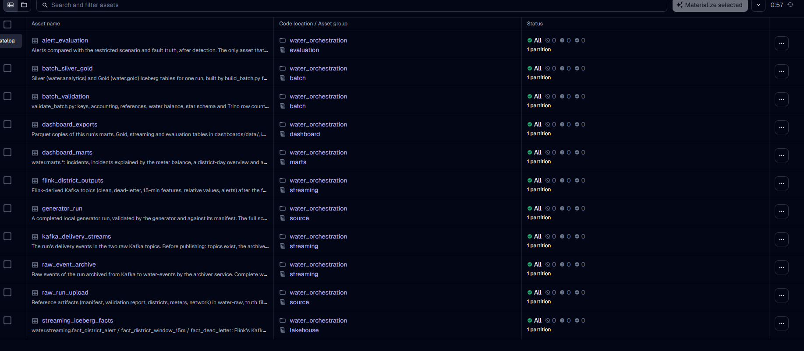
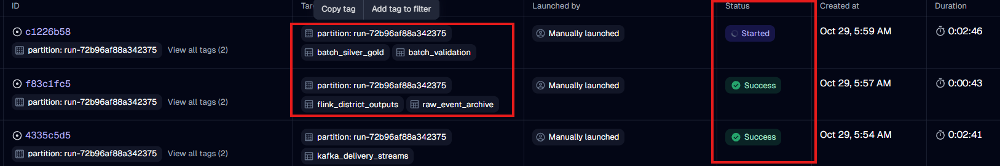

# 3. Orchestration with Dagster

## Why an orchestrator at all

Without one, running this pipeline means typing about twenty commands in the right order and checking each result
by eye. Worse, "the command finished" does not mean "the data is complete": a publisher can finish while the
archiver is still writing, a Flink job can be running while it has not yet processed the last records. The
orchestrator's real job here is to **prove** each step is complete before the next one starts, and to make a second
run safe.

## Dagster in five ideas

1. **Asset.** A named piece of data the pipeline produces, e.g. `raw_event_archive`. A Python function says how to
   produce it and *checks that it is correct*. "Materializing" an asset means running that function.
2. **Dependencies.** An asset lists the assets it needs. Dagster draws the graph and runs things in order.
3. **Partition.** One copy of every asset per generator run (`run-72b96af88a342375`). A new dataset is a new
   partition; old ones are untouched.
4. **Job.** A named selection of assets to run together (e.g. `batch_run`).
5. **Resource.** A small client the assets share: Docker Compose, Kafka, MinIO, Flink, Trino.

Dagster runs on your machine (not in Docker) from `orchestration/`. It drives the containers with the same
`docker compose` commands a person would type, so nothing is hidden.

*All eleven assets, each materialized for one partition. The description under each name is written in the code.*

## The eleven assets, in order

| Group | Asset | What it does | How it proves success |
|---|---|---|---|
| source | `generator_run` | Checks a generated run on disk | `_RUN_COMPLETE` exists; the manifest is from the current generator; the generator's own schema validation passes; line counts equal the manifest. Skips the slow schema check when the files have not changed since it last passed. |
| source | `raw_run_upload` | Uploads reference files and the answer key to MinIO | Every object's size equals the local file; `_RUN_COMPLETE` is written **last**. A run that already has the marker is only verified, never re-uploaded. |
| streaming | `kafka_delivery_streams` | Publishes the run into Kafka | Before: topics exist, the archiver runs, the four Flink jobs run. After: Kafka gained exactly the manifest's record counts. A run is published at most once. |
| streaming | `raw_event_archive` | Proves the archive is complete | The archiver's committed position is past the last published record, and the archived files cover every published offset with no gap. Optionally compares every archived line with the original file. Writes `archive-manifest.json`. |
| streaming | `flink_district_outputs` | Proves Flink processed everything | Each Flink job's committed position reached the end of its input, one job after another; the clean topic has exactly one row per logical event. Freezes the output positions for this run. |
| batch | `batch_silver_gold` | Runs `build_batch.py` in Spark | The job reports `completed`, or `skipped` if this exact input was already processed. |
| batch | `batch_validation` | Runs `validate_batch.py` | Reports `passed` (keys, accounting, water balance, star schema, Trino row counts). |
| lakehouse | `streaming_iceberg_facts` | Runs `load_streaming.py` | Loads Flink's topics into `water.streaming`, up to the frozen positions. |
| evaluation | `alert_evaluation` | Compares alerts with the answer key | Must give exactly the same numbers as the Flink teammate's `evaluate_alerts.py`. The only asset allowed to read `water-restricted`. |
| marts | `dashboard_marts` | Rebuilds the four Trino marts for this run | Row counts reported per mart. |
| dashboard | `dashboard_exports` | Exports tables to Parquet for Power BI | Rows per exported table. |

Plus one job that is not an asset: **`generate_dataset_job`** runs the generator for a config file and registers the
new run as a partition, and **`live_demo`** replays a small run for the live board (see [4. Streaming path](04-streaming.md)).

## The state that makes re-running safe

Dagster keeps its run history in `orchestration/.dagster_home`, but the facts that protect the data are stored in
MinIO **next to the data**, so they survive even if Dagster's history is deleted:

| File | What it records | What it prevents |
|---|---|---|
| `water-raw/<run>/_RUN_COMPLETE` | the raw upload finished | Spark reading a half-uploaded run |
| `water-events/_orchestration/stream.json` | each run's publication state (`publishing` → `published`) and Kafka positions before and after | publishing the same run twice; continuing after an interrupted publication without checking |
| `water-events/_manifests/<run>/archive-manifest.json` | the exact archive files that make up the run | Spark reading an incomplete archive |
| Iceberg `analytics.batch_manifest` | a fingerprint of the batch input and `processing`/`completed` | rebuilding an unchanged run; using a half-written run |

### What a second run actually did

We re-ran all eleven assets for the same partition. It took 4.2 minutes and every step recognised its work:

- generator: "files unchanged since the last passed validation"
- publication: "already published, not publishing again"
- archive: manifest re-checked, not rewritten
- Flink outputs: frozen positions reused
- batch: `skipped` ("source fingerprint already completed")
- validation passed again and the marts were rebuilt with identical row counts

## Three guards worth knowing

**Publication guard and resume.** The first publication of our 3.8 M records was interrupted after 3.3 M records by a
short Kafka hiccup (the broker briefly lost its leadership role). Publishing again would have duplicated 3.3 M
records. Instead, `kafka_delivery_streams` can be re-run with `resume_interrupted: true`: it replays the generator's
own (deterministic) order, proves Kafka holds an exact prefix of it (same count per topic, same last message), and
sends only the remaining 500,120 records. The run log below shows the 2:41 resume run.

**One Spark job at a time.** Dagster runs independent steps in parallel. Two Spark containers at once would fight
over port 4040 and memory, so every Spark asset carries the tag `resource: spark` and the executor allows one at a time.

**Never submit a Flink job twice.** Jobs get stable names (`ewi-validation`, ...). Dagster submits only missing jobs,
and only before anything has been published. A job that died after publication is reported for manual recovery from
its savepoint instead of being restarted from scratch, because restarting from scratch would emit duplicate results.

## Sensors (automatic, off by default)

| Sensor | When on, it ... |
|---|---|
| `generator_run_sensor` | registers every new completed folder in `Generator/output/` as a partition |
| `archive_complete_sensor` | starts the batch job for each run whose archive manifest exists, exactly once per run |

Together they make the pipeline incremental: a new dataset appears, gets registered, and is batch-processed as soon
as its archive is proven complete, without touching earlier runs.

## Screenshot prompts

Every asset that produces something visible logs a line starting with `[SCREENSHOT]` with the URL to open.

## Code map

| File | Content |
|---|---|
| `orchestration/water_orchestration/__init__.py` | the definitions: assets, jobs, sensors, resources, executor |
| `assets/source.py`, `streaming.py`, `batch.py`, `lakehouse.py` | the eleven assets, by stage |
| `resources.py` | thin clients: Docker Compose, Kafka, Flink REST, Trino REST, MinIO |
| `archive.py` | the archive completeness check (which files cover which offsets) |
| `evaluation.py` | the evaluation rules, ported from `flink/analysis/evaluate_alerts.py` |
| `demo.py` | the live demo job |
| `checks.py`, `settings.py`, `sensors.py`, `screenshots.py` | small helpers |
| `tests/` | unit tests for the pure logic (`uv run pytest`) |
