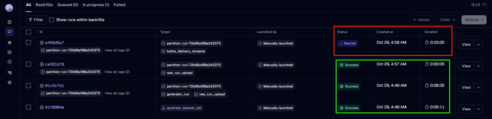
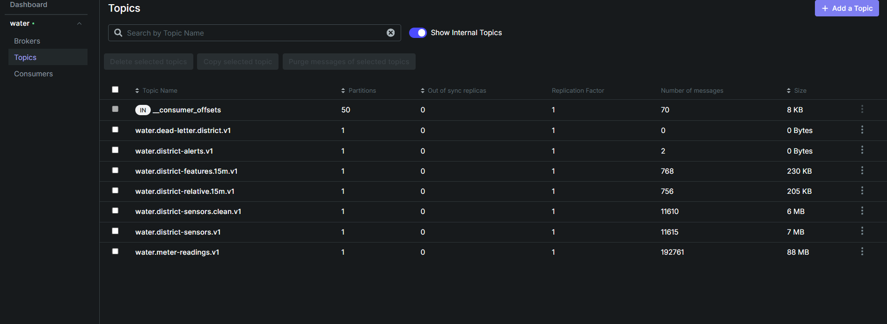
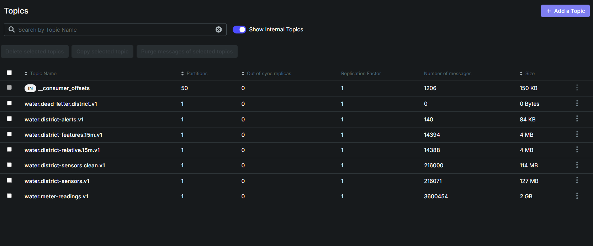
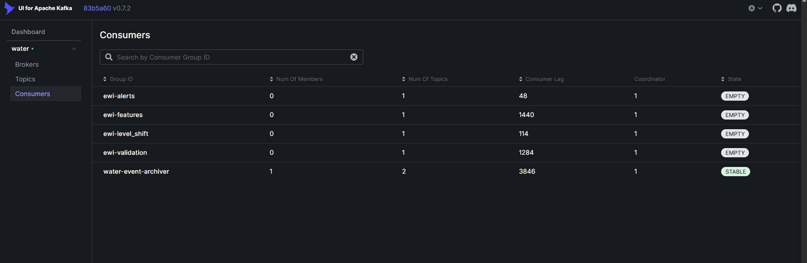
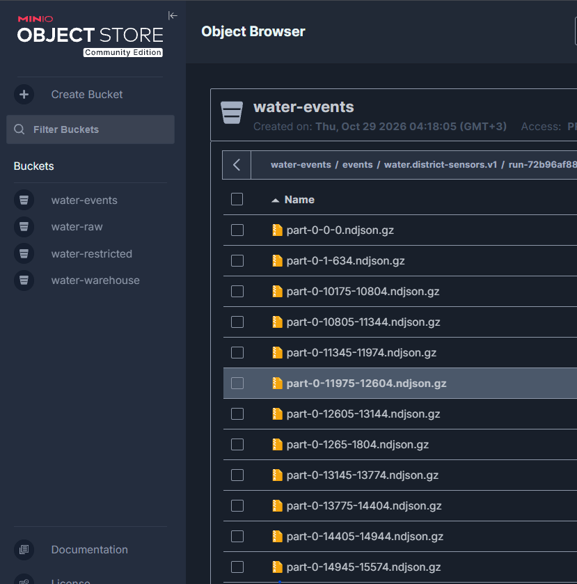
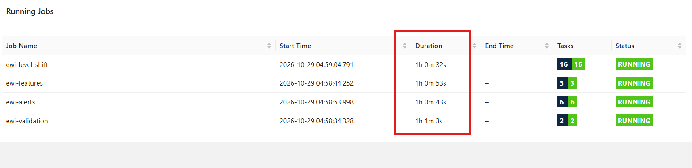
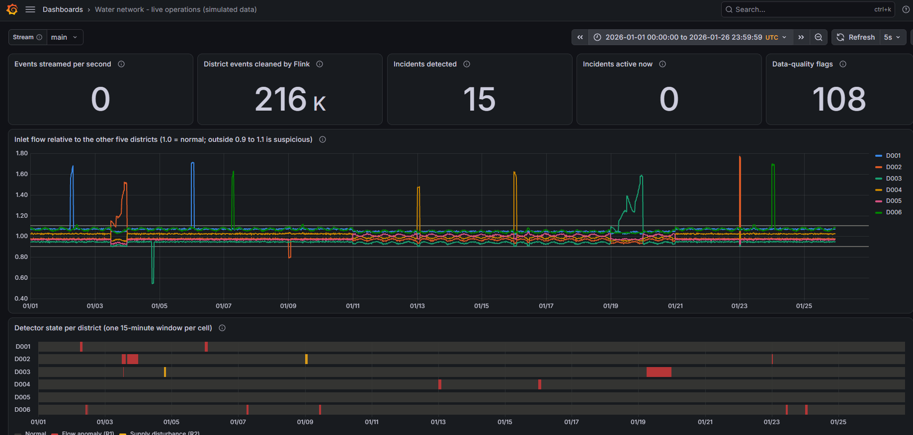
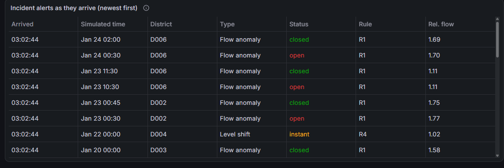

# 4. The streaming path: Kafka, the archiver, Flink and the live board

## Publishing into Kafka

The generator's publisher (`water-generator publish-kafka`, unchanged teammate code) reads the two delivery files,
merges them in **availability-time order** (the order the readings would have arrived in reality) and sends every
record to Kafka, waiting for Kafka to acknowledge each one. The record's key is its `event_id`.

- Rate on this laptop: about 1,000 records per second, so the full 3.8 M records take about an hour.
- The `--speed` option can slow it down to simulate real time (speed 480 = 2 simulated days in 6 minutes).
- It is at-least-once: if it is interrupted it cannot know which of the last records arrived. That is why the
  orchestration adds the verified resume described in [3. Orchestration](03-orchestration.md).

*Dagster's run list: generation, validation and upload done (green); the publication run still in progress after
33 minutes, because the publisher waits for Kafka's acknowledgement of every one of the 3.8 M records.*

*Kafka during publication. The raw topics are filling up, and Flink's derived topics (clean, features, relative,
alerts) are already growing next to them: Flink processes the data while it arrives.*

*After publication: exactly 216,071 district and 3,600,454 meter messages, the manifest counts. Flink kept 216,000
clean readings (the 71 duplicates removed), 14,394 feature windows and 140 alerts.*

## Consumers read independently

Kafka remembers how far each **consumer group** has read. The archiver and every Flink job use their own group, so
each one receives every message, no matter how fast the others are.

*Five independent consumer groups: the archiver (`water-event-archiver`, reading both topics) and the four Flink
jobs. "Lag" is how many messages a group still has to process. Flink groups show EMPTY because Flink only commits
its position at checkpoints, it does not keep a live member in the group.*

## The archiver: Kafka → MinIO

The archiver (`Generator/.../archiver.py`, unchanged teammate code) runs permanently. It buffers messages per
topic, run and partition, and every 10,000 messages or 30 seconds writes one gzip file to MinIO named after the exact
Kafka positions it contains: `part-<partition>-<first>-<last>.ndjson.gz`.

Two properties make it trustworthy:

- **It commits its Kafka position only after the file is safely in MinIO.** If it crashes before committing, it
  simply re-reads those messages after a restart. Nothing is lost. (We added `restart: unless-stopped` so a crash
  or a MinIO outage does not leave it dead.)
- **The file names contain the offsets**, so anyone can check which part of the stream a file covers.

*The district archive: each file name says which Kafka offsets it holds (e.g. offsets 10175–10804).*

### How we know the archive is complete

"The publisher finished" does not mean "everything is archived": the archiver may still hold up to 30 seconds of
messages in memory. And "nothing new arrived for a while" means nothing either, because a slow publisher can pause.
So `raw_event_archive` proves completeness from two facts:

1. the archiver's **committed** Kafka position is at or past the last published position (it only commits after
   writing to MinIO), and
2. the archive files' offset ranges **tile** the published range exactly, with no gap. If a crash produced two files
   overlapping the same offsets, one consistent set is chosen and the overlap is reported.

It then compares every archived line with the original delivery file (a fingerprint of all 3.8 M lines). Result for
our run: 723 files, no overlap, every line identical. The proof is written to
`water-events/_manifests/<run>/archive-manifest.json`, which is what the batch job requires before it starts.

## Flink: the four detection jobs (teammate work, unchanged)

| Job | Reads | Does | Writes |
|---|---|---|---|
| `ewi-validation` (`job2_district_validation.py`) | raw district topic | rejects malformed records to a dead-letter topic; keeps null pressures but flags them; removes duplicate `event_id`s | clean topic, dead-letter topic |
| `ewi-features` (`job3_district_features.py`) | clean topic | 15-minute windows per district: average flow, volume, pressures, counts | features topic |
| `ewi-alerts` (`job3b_district_alerts.py`) | features topic | compares each district with the median of the other five; rules R1 (flow anomaly), R2 (supply disturbance), R3 (data quality) | relative topic, alerts topic |
| `ewi-level_shift` (`job3c_level_shift.py`) | relative topic | compares each district's daily level with its own previous 6 days; rule R4 (persistent loss) | alerts topic |

*The four jobs, running continuously for over an hour while the data streamed in.*

What the orchestration adds around them: stable job names and consumer groups (`-Dpipeline.name=ewi-<key>`, `--group-id
ewi-<key>`), submission only when missing, and proof of completion (each job's committed position reaches the end of
its input, in pipeline order). Two facts about finite replays are built into the expected numbers rather than treated
as errors: the very last 15-minute window never closes (so 6 × 2,399 = 14,394 feature rows, not 14,400), and the last
day never closes for the level-shift rule.

## How Flink's results reach Iceberg

Flink writes only to Kafka topics. We deliberately did **not** add an Iceberg sink to the Flink jobs: that would have
meant new jars in the Flink image and changes to the teammate's jobs. Instead, after `flink_district_outputs` proves
Flink is done with a run, a Spark job (`batch/jobs/load_streaming.py`) copies the results into Iceberg:

1. **Frozen end positions.** When Flink is verified, the end offset of every output topic is saved in
   `stream.json`. The load reads each topic only up to those positions. This matters because Flink's output rows do
   not carry a `run_id`: anything published later must never be mistaken for this run.
2. **A bounded Kafka read.** Spark reads `earliest → frozen end` of the four topics (alerts, features, relative,
   dead-letter) with its built-in Kafka connector.
3. **Duplicates removed.** Flink's Kafka output is at-least-once (a restart can repeat rows), so alerts are
   de-duplicated on `alert_id` and windows on district + window start.
4. **Tagged and written.** The run's ID is added, and three tables are written in `water.streaming`, replacing only
   this run's partition: `fact_district_alert` (140 rows), `fact_district_window_15m` (14,394), `fact_dead_letter` (0).

**Limitation, stated openly:** because Flink's rows have no `run_id`, one Kafka namespace can carry the streaming
results of only one run. A second run published into the same topics is still archived and batch-processed, but its
streaming results are not loaded. Changing the Flink jobs to carry `run_id` would remove this limit.

## The live board: Grafana fed by a live bridge

The Power BI dashboard shows completed, verified data. To show the streaming path doing its job **live**, there is a
second, operational view:

- **Live bridge** (`live/bridge.py`, a small always-on service): reads Flink's output topics (main and demo) and
  writes them into a `live` schema in Postgres, keyed by `alert_id` or district + window so re-reading can never
  duplicate a row. Every 2 seconds it also records the topics' end positions, which the board turns into
  "events per second".
- **Grafana** (http://localhost:3001, no login): refreshes every 5 seconds and reads that schema through a read-only
  database role.

*The live board on the full run: every planted incident is visible as a spike (bursts, surges, leaks) or a dip
(supply disturbances) in a district's flow relative to the others; the detector-state timeline below marks each
15-minute window Flink flagged; the tiles show 216 K cleaned events, 15 incidents and 108 data-quality flags.*

*Incident alerts as Flink emitted them: each incident has an "open" and a "closed" alert; R4 level shifts are single
"instant" alerts.*

## The live demo

For the presentation there is a one-button replay: the Dagster job `live_demo`. It uses a small dataset
(`configs/demo-live.yml`: 2 days, 6 planted incidents) and a completely separate `demo.` namespace:

1. generates the demo run if missing,
2. optionally stops the main Flink jobs with savepoints (to free task slots),
3. deletes and recreates **only** the `demo.*` topics and clears only the demo rows of the live tables,
4. starts the four Flink jobs again on the demo topics,
5. replays the demo run at speed 480, about 6 minutes, while the Grafana board (stream = demo) shows incidents being
   detected roughly every 40 seconds.

The main run's topics, archive and tables are never touched, so the demo can be repeated. **Status: implemented but
not yet run end to end**; test it before the presentation (see [Running the system](RUNNING.md)).
