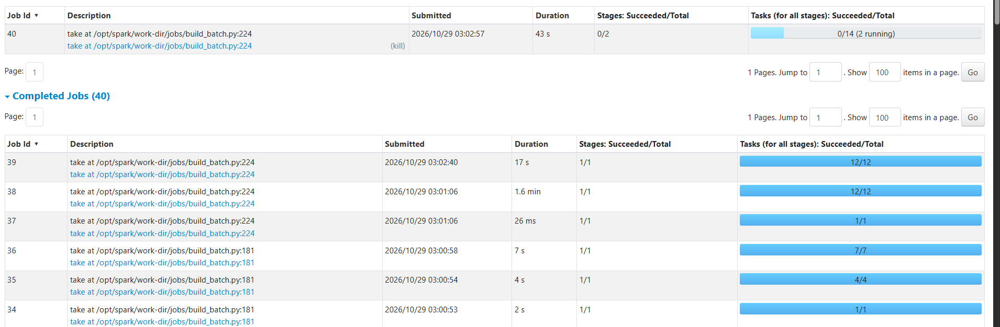

# 5. The batch path: Spark, incremental processing and the edits we made

The batch job (`batch/jobs/build_batch.py`) is the batch teammate's work. Its cleaning rules, water-balance logic
and star schema are theirs. What we changed is **where it reads from**, **how it decides a run is ready**, a write
optimisation, and three extra Gold tables. Every edit is listed at the end of this page.

## What one batch run does

For one generator run:

1. **Check the run is ready** and fingerprint its input (details below).
2. **Read** the reference lists (districts, meters) from `water-raw` and the events from the Kafka archive in
   `water-events`, exactly the files listed in the archive manifest.
3. **Clean** each stream: reject malformed JSON, wrong schema version, wrong run, unknown districts/meters, invalid
   timestamps, wrong interval length, negative or missing measures, bad quality codes. Rejected records are kept with
   their reasons. Identical duplicates collapse to one; two *different* records with the same `event_id` stop the build.
4. **Water balance** per district and 15-minute interval: water that entered (sum of 15 one-minute inlet volumes) vs
   water metered at customers (sum of that district's meters). An interval is "complete" only if all 15 minutes and
   all expected meters are present; incomplete intervals get no gap value instead of a misleading one.
5. **Gold**: dimensions, facts and daily aggregates.
6. **Write** every table, replacing only this run's partition, then mark the run `completed`.

*The live Spark UI during `build_batch.py`: each line is one Spark job (a step of the build).*

### Result for our run

| Stream | Read from the archive | Accepted | Rejected (nulls) | Duplicates collapsed |
|---|---|---|---|---|
| District | 216,071 | 215,892 | 108 | 71 |
| Meter | 3,600,454 | 3,599,280 | 720 | 454 |

Every number matches the faults that were injected. The validator (`validate_batch.py`) then re-derives everything
independently and returns `passed`.

## Incremental processing: how the delta is captured

"Incremental" means each new piece of data is processed once, without re-processing old data. Here the unit of new
data is **one generator run**: an immutable batch with a known, complete set of events.

| Question | Our answer |
|---|---|
| How is the delta captured? | Each run's events are a fixed, known set of Kafka offsets. The archive manifest lists exactly which archive files hold them, and is written only after the archive is proven complete. |
| When is a run eligible? | Only when `_RUN_COMPLETE` exists in `water-raw` **and** a complete archive manifest exists. A missing piece raises a clear `SourceNotReady` error instead of reading partial data. |
| What does each batch read? | Only that run's archive files and two small reference files. It never lists the whole bucket and never re-reads earlier tables. |
| What does it write? | Only that run's partition in each table (`overwrite where run_id = X`). Other runs' files are never rewritten. |
| What happens on a re-run? | A fingerprint (sizes, ETags and timestamps of every input file, plus a pipeline version) is compared with the stored one. Unchanged → `skipped` in seconds. Changed → refused unless `--reprocess` is given. |
| What if it fails half-way? | `batch_manifest` says `processing` (it is set to `completed` last), so nobody uses the half-written run, and retrying overwrites the same partitions. |
| How does a new run get processed automatically? | The `archive_complete_sensor` in Dagster starts the batch job once per run as soon as its archive manifest appears. |

### How this compares with common practice

- **Per-partition overwrite vs MERGE.** Iceberg and practitioner guidance recommend overwriting whole partitions for
  append-style batch data (simple and atomic per partition) and `MERGE` for tables where individual rows change.
  Our runs never change once complete, so partition overwrite is the right tool, and the cheaper one.
- **Tracking processed files.** Tools such as Databricks Auto Loader keep a record of every file already processed so
  each is ingested exactly once. Our archive manifest plays that role, with one extra guarantee: it is only written
  after the files are proven to cover the stream completely.
- **Completion recorded last.** Writing the completion marker after the data (`batch_manifest`, `_RUN_COMPLETE`,
  archive manifest) is the standard way to make multi-step writes safe to read.

### Keeping the work small

- Reference tables are tiny and are **broadcast** in joins, so the large event tables are not shuffled for them.
- Every Iceberg table is created with `write.distribution-mode = none`. Iceberg's default re-shuffles rows by
  partition before writing; because each write contains exactly one `run_id`, that default would push all 3.6 M rows
  through a single writer task for nothing.
- Intermediate results are persisted to disk once and reused by the cleaning, balance and Gold steps.

Sources: [Iceberg Spark writes](https://iceberg.apache.org/docs/nightly/spark-writes/),
[Idempotent pipelines](https://datalakehousehub.com/blog/2026-02-de-best-practices-04-idempotent-pipelines),
[Idempotency and backfill](https://datadriven.io/learn/pa_idempotency_intermediate),
[MERGE INTO patterns for Iceberg](https://www.dremio.com/blog/merge-into-patterns-for-apache-iceberg-upserts-and-scd-type-2),
[Databricks Auto Loader](https://docs.databricks.com/ingestion/auto-loader/).

## The tables

| Namespace.table | One row is | Rows (our run) |
|---|---|---|
| `analytics.district_clean` / `meter_clean` | one accepted event | 215,892 / 3,599,280 |
| `analytics.rejected_events` | one rejected delivery, with reasons and raw JSON | 828 |
| `analytics.water_balance_15m` | one district × 15 minutes | 14,400 |
| `analytics.quality_report` | one stream: read / accepted / rejected / duplicates | 2 |
| `analytics.batch_manifest` | one run's fingerprint and status | 1 |
| `gold.dim_district`, `dim_meter`, `dim_interval` | one district / meter / 15-minute interval | 6 / 1,500 / 2,400 |
| `gold.fact_water_balance_15m` | one district × 15 minutes | 14,400 |
| `gold.fact_meter_consumption_15m` | one meter × 15 minutes | 3,599,280 |
| `gold.gold_district_daily_water_balance` | one district × day | 150 |
| `gold.gold_district_daily_consumption_by_class` *(new)* | one district × day × customer class | 300 |
| `gold.gold_data_quality_daily` *(new)* | one district × day × stream × outcome | 558 |

`dim_interval` also gained Cairo local-time columns *(new)*: local date, local hour, weekday name and number, and a
weekend flag (Friday/Saturday), because demand follows local habits, not UTC.

## Every edit we made to the batch code

| File | Edit | Why |
|---|---|---|
| `build_batch.py` | Events now come from the Kafka archive (`water-events`), limited to the files in the archive manifest | The agreed architecture: Kafka → archive → Spark, and Spark must never read a partial archive |
| `build_batch.py` | Fingerprint covers the archive manifest and every archive file; `SourceNotReady` error | Detect changed input; fail clearly when a run is not ready |
| `build_batch.py` | `PIPELINE_VERSION` 2 → 3 | The input contract changed, so old fingerprints must not match |
| `build_batch.py` | `write.distribution-mode = none` on new tables | Avoid a pointless shuffle into one writer |
| `build_batch.py` | Cairo time columns; `gold_district_daily_consumption_by_class`; `gold_data_quality_daily` | Dashboard needs: demand by local hour and weekday, by customer class, and data quality per day |
| `validate_batch.py` | `check_dashboard_gold`: reconciles the three additions with their sources | Every new table is independently checked |
| `test_batch.py` | Tests for reading gzip archive parts (with a duplicate) and for the new Gold tables | Prove the new input path and the new tables on small fixtures |
| `handoff_smoke.py` | Counts events from the archive instead of `water-raw/<run>/delivery/` | No Spark code reads a direct file copy of the events |
| `load_streaming.py` *(new)* | Loads Flink's topics into `water.streaming` | See [4. Streaming path](04-streaming.md) |
| `export_dashboard.py` *(new)* | Exports one run's tables to Parquet for Power BI | Power BI Desktop cannot query our local Trino reliably |
| `batch/Dockerfile` | Spark–Kafka connector jars; event log for Spark History | Bounded Kafka reads; finished jobs visible in the history server |

The Spark container also gets `AWS_REGION` from `docker-compose.yml`: Iceberg's S3 client refuses to start without a
region, even against MinIO.
