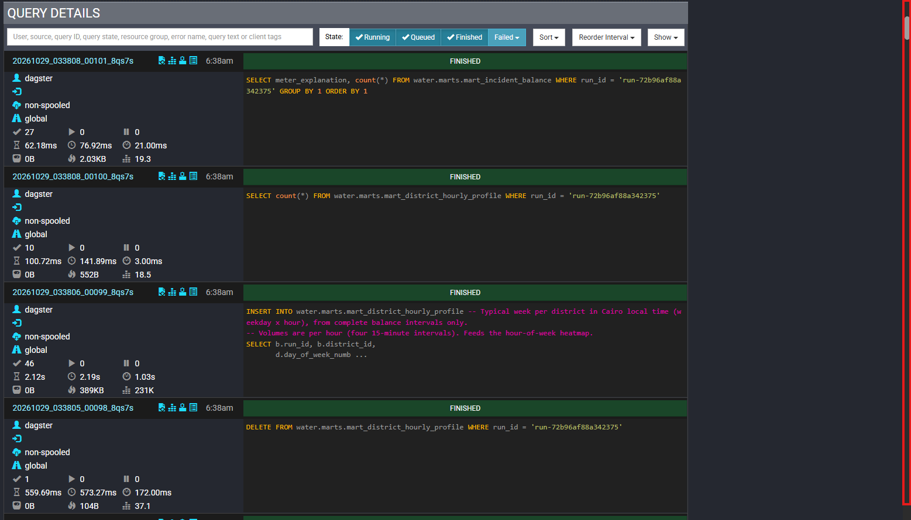
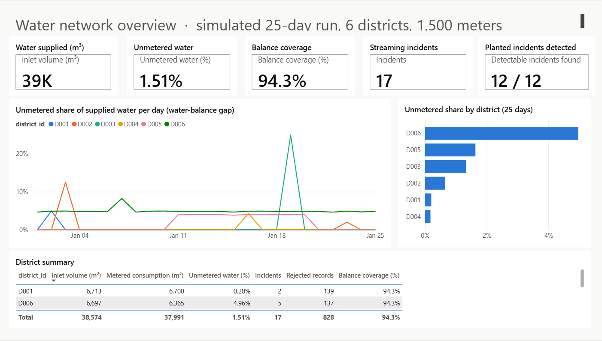
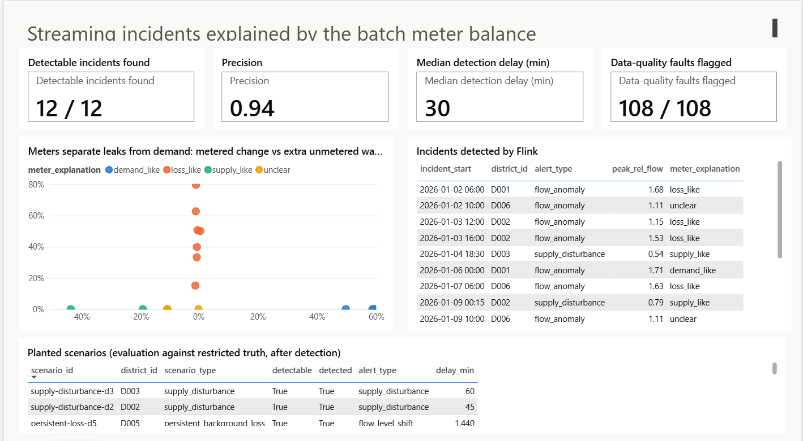
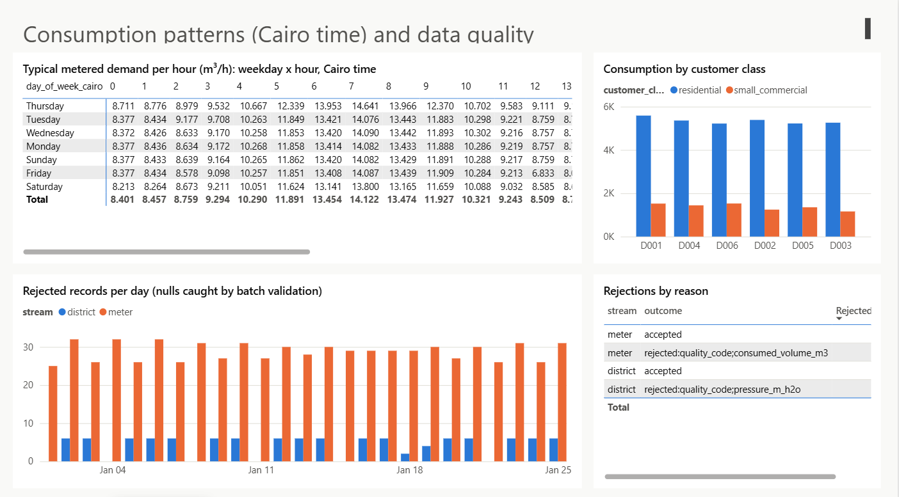

# 6. Lakehouse, marts and results

## Iceberg + Trino in this project

Spark writes Iceberg tables; Trino reads (and writes) the very same tables, because both use the same catalog
(PostgreSQL) and the same warehouse bucket (`water-warehouse` in MinIO). Nothing is copied between them. Trino is
where the two paths, batch and streaming, are finally joined.

*Trino's query log while Dagster rebuilds the marts: for each mart, a `DELETE` of this run's rows followed by an
`INSERT ... SELECT`, so marts are rebuilt per run without touching other runs.*

## The four marts

Each mart is one plain SQL file in `infrastructure/trino/marts/`, numbered in dependency order.

### `mart_incidents`: one row per incident detected by Flink

Flink emits an `open` alert when an incident is confirmed (two consecutive suspicious 15-minute windows) and a
`closed` alert when it ends. This mart pairs them into one row: start, confirmation time, end, detection delay,
duration, and the peak relative flow reached. Level-shift (R4) alerts are single rows spanning one day.
Our run: 17 incidents.

### `mart_incident_balance`: did the meters see lost water or higher demand?

This is the most important result of combining the two paths. From district sensors alone, a **burst** (water
leaking out) and a **demand surge** (customers using more) look identical: inflow goes up. The meters tell them
apart. For every flow or supply incident, the mart compares the 15-minute intervals inside it with that district's
normal level at the same Cairo weekday and hour:

| Classification | What the meters show | Meaning |
|---|---|---|
| `loss_like` | inflow up, metered consumption flat, so unmetered water rises above 10% of normal inflow | water is being lost |
| `demand_like` | inflow and metered consumption rise together (more than 10%) | customers really used more |
| `supply_like` | inflow down more than 10% | the supply side failed |
| `unclear` | none of the above | small or ambiguous signal |

It uses no answer-key data, only measurements. Our run: every burst and gradual leak came out `loss_like`
(unmetered water +15% to +80%), all three demand surges `demand_like` (+50% to +60% metered), both supply
disturbances `supply_like`, and three small D006 flags `unclear` (explained below).

### `mart_district_daily_overview`: the main dashboard grain

One row per district and day: water supplied, water metered, the gap, coverage, incidents opened, level-shift and
data-quality alerts, accepted and rejected records.

### `mart_district_hourly_profile`: a typical week

Average supplied and metered water per hour for each district, weekday and Cairo hour (6 × 7 × 24 = 1,008 rows),
from complete intervals only. It feeds the hour-of-week heatmap.

## Evaluation against the answer key

Only after detection has finished does `alert_evaluation` open the restricted answer key (`water-restricted`) and
compare it with the alerts. It uses the Flink teammate's rules from `flink/analysis/evaluate_alerts.py`, and the
orchestration runs that original script as well and requires identical numbers.

| Measure | Result |
|---|---|
| Detectable planted incidents found | **12 of 12** |
| False alarms | 1 (precision 0.94) |
| Detection delay | 30 min for bursts and surges, 45–60 min for supply disturbances, 1 day for the persistent loss (rule R4 works on daily levels), 6.5 h for the slow one-day leak |
| Data-quality faults flagged (null pressures) | **108 of 108** |

Two findings worth explaining in a presentation:

- **The false alarm** is a level-shift (R4) alert on D004 on Jan 21. That is the exact moment the D005 persistent
  loss *ends*: D005's inflow drops back, which lowers the "median of the other districts" D004 is compared with, so
  D004 suddenly looks 3.4% higher than its own history, just over the 3% threshold. It is the peer-comparison effect
  the Flink teammate documented as a known limit of R4.
- **The D006 background loss** exists from minute one, so its flow never *changes* and the stream cannot see it. The
  batch water balance can: D006 has by far the largest unmetered share (4.96% over 25 days). It even leaks into the
  stream briefly: during Friday prayer (12:00 Cairo) demand drops, the constant leak becomes a larger share of the
  inflow, and D006 crosses the 10% threshold. Those are the three `unclear` D006 incidents on Jan 2, 9 and 23, all Fridays.

| District | Unmetered water over 25 days | Why |
|---|---|---|
| D006 | 4.96% | constant background leak |
| D005 | 1.63% | persistent loss from day 11 to day 20 |
| D003 | 1.33% | one-day gradual leak |
| D002 | 0.65% | gradual leak and a short burst |
| D001 | 0.20% | one burst (the demand surge adds no gap) |
| D004 | 0.18% | one burst (the demand surge adds no gap) |

## The dashboards

There are two dashboards with different jobs. Neither is stored in this repository: they are generated locally
(see the private handbook), and the screenshots below show what they look like.

**Grafana, live operations** (http://localhost:3001): what the streaming path sees right now. See
[4. Streaming path](04-streaming.md).

**Power BI, analysis** (three pages), built on Parquet exports of the marts and Gold tables:

*Network overview: water supplied, unmetered share, balance coverage, incidents, planted incidents found; the daily
unmetered share per district (D006's constant leak, D005's 10-day loss, D003's one-day leak are all visible) and the
district summary.*

*Incidents: the scatter puts every Flink incident at (metered change, extra unmetered water); leaks rise vertically,
demand surges sit to the right, supply problems to the left. Below, the evaluation per planted scenario.*

*Consumption and data quality: typical demand per weekday and Cairo hour (morning and evening peaks, the Friday
prayer dip), consumption per customer class, and the records rejected per day.*

All values are simulated.
