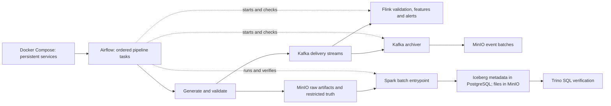
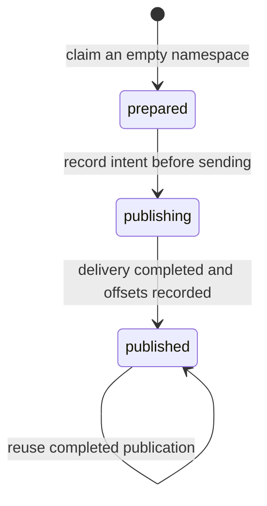

# What changed and why

Prepared for Amr Yousri and the SIC Team 4 project. This records the work completed in this session through **26 October 2026**. It describes the code in this checkout and the checks actually performed. For operating instructions, read the [complete usage guide](USER_GUIDE.md).

## Contents

- [1. Request and starting point](#1-request-and-starting-point)
- [2. Resulting architecture and ownership](#2-resulting-architecture-and-ownership)
- [3. File-by-file change inventory](#3-file-by-file-change-inventory)
- [4. Infrastructure decisions](#4-infrastructure-decisions)
- [5. Airflow execution decisions](#5-airflow-execution-decisions)
- [6. Data contracts and repeatability](#6-data-contracts-and-repeatability)
- [7. Build and startup problems resolved](#7-build-and-startup-problems-resolved)
- [8. Verification and its limits](#8-verification-and-its-limits)
- [9. Remaining team work](#9-remaining-team-work)
- [10. Repository organization and cleanup](#10-repository-organization-and-cleanup)

## 1. Starting point

At the start of this work, the tracked checkout already contained the hydraulic generator, Kafka, MinIO, the Kafka archiver, Flink jobs, manual Flink scripts and analysis utilities. The shared Compose definition did not provide the Airflow/Spark/Iceberg/Trino integration implemented here. Some Docker containers from an older local configuration existed independently of the current tracked files; their presence did not mean that configuration was reproducible from this checkout.

The previous batch guide described raw paths and services that did not match the actual uploader and Compose files. A new teammate would otherwise need to discover those differences while writing transformations.

The work therefore covered orchestration, infrastructure, input contracts, teammate entrypoints, operating documentation and verification. It also addressed the build and startup errors encountered when using the resulting stack.

## 2. Resulting architecture and ownership



The diagram shows the implemented integration. The current Spark entrypoint produces smoke-test evidence. Flink's current sinks are Kafka topics; a direct Flink-to-Iceberg connection is still team work.

| Owner | Responsibility | What this work provides |
| --- | --- | --- |
| Amr Yousri | Airflow orchestration and shared Docker infrastructure | Reproducible services, task ordering, runtime helpers, retry guards, monitoring and runbooks |
| Amr AbdEl-Monem | PySpark transformations and analytical Iceberg tables | A container runtime, shared catalog, exact raw paths, a smoke job and extension instructions |
| Ahmed Sayed | Flink rules and streaming integration | Existing jobs are submitted and checked by Airflow; their detection logic was retained |
| Generator/data owner | Synthetic source generation and delivery | Existing simulation is reused with a small smoke configuration and a generation wrapper |

Compose starts infrastructure processes, including Airflow itself. Airflow then executes the data workflow and manages submissions to those processes. A Flink job can continue processing after an Airflow task finishes; keeping an Airflow task running forever would prevent a finite pipeline run from completing.

## 3. File-by-file change inventory

Paths below are relative to the repository root. “Existing” identifies code already present before this work; it is not a claim that every line in the file was newly implemented.

| File or group | Change | Reason |
| --- | --- | --- |
| [docker-compose.yml](../docker-compose.yml) | Consolidated the full stack, including Flink; added shared task environment, explicit local image names, Airflow services, two PostgreSQL services, Spark build target, Trino, named output volume, explicit network name and network labels | Make the integrated runtime reproducible and give tasks stable connections and storage |
| Flink services in `docker-compose.yml` | Added network labels and adjusted memory to 2 GB for JobManager and 4 GB for TaskManager | Support four concurrent jobs and recreate services when the resolved network changes |
| [.env.example](../.env.example) | Added documented example configuration | Make required settings discoverable without committing a private `.env` |
| `.env` on this workstation | Set `DOCKER_GID=1001` | Match the observed Docker socket group; this is local configuration, not a portable repository default |
| [.gitignore](../.gitignore) | Added private environment, Python caches, pytest cache and generated output exclusions | Keep secrets and runtime artifacts out of version control |
| [scripts/start-pipeline.sh](../scripts/start-pipeline.sh) | Added Linux/WSL startup sequence, Docker checks and socket-group detection | Provide one entrypoint for building and starting the environment |
| [scripts/start-pipeline.ps1](../scripts/start-pipeline.ps1) | Added PowerShell equivalent with command failure checks | Support teammates using Windows terminals |
| [orchestration/Dockerfile](../orchestration/Dockerfile) | Added Airflow 2.10.5 / Python 3.11 image and Docker, Kafka and MinIO SDKs, using Airflow constraints | Give task processes the clients required to operate the whole workflow |
| [orchestration/dags/egypt_water_pipeline.py](../orchestration/dags/egypt_water_pipeline.py) | Added pipeline and health DAGs | Define the workflow and ongoing checks in Airflow |
| [orchestration/dags/water_pipeline/runtime.py](../orchestration/dags/water_pipeline/runtime.py) | Added executable task helpers | Centralize container execution, service lookup, stream ownership, Flink reuse, offset checks and Trino verification |
| [orchestration/dags/water_pipeline/__init__.py](../orchestration/dags/water_pipeline/__init__.py) | Added helper package | Keep runtime code separate from the DAG definition |
| [Generator/configs/smoke.yml](../Generator/configs/smoke.yml) | Added a sixty-minute, six-district, twelve-meter configuration | Allow a small integration experiment without generating the full pilot dataset |
| [Generator/scripts/generate_pipeline_run.py](../Generator/scripts/generate_pipeline_run.py) | Added config-derived run lookup, filesystem locking, completed-run reuse and a JSON receipt | Connect deterministic generation to Airflow without using a hardcoded run directory |
| [Generator/scripts/init_services.py](../Generator/scripts/init_services.py) | Extended existing initialization to seven topics and four buckets; avoided empty topic-creation requests | Prepare every current pipeline dependency and allow repeated initialization |
| [Generator/src/egypt_water_intelligence/generator/integrations.py](../Generator/src/egypt_water_intelligence/generator/integrations.py) | Added required-file preflight and completion-marker upload after the existing archive uploads | Prevent a batch reader from treating a newly incomplete upload as ready |
| [flink/Dockerfile](../flink/Dockerfile) | Copied existing job scripts into the image | Provide job files in a self-contained image as well as the development bind mount |
| [batch/Dockerfile](../batch/Dockerfile) | Added Spark, compatible Iceberg jars, PostgreSQL driver and MinIO SDK | Provide Amr AbdEl-Monem's batch runtime |
| [batch/jobs/handoff_smoke.py](../batch/jobs/handoff_smoke.py) | Added raw-object counting, manifest checks and an Iceberg evidence row with read-back | Exercise the storage/query integration before analytical transformations are added |
| [infrastructure/catalog-db/init.sql](../infrastructure/catalog-db/init.sql) | Added Iceberg JDBC metadata schema V1 | Give Spark and Trino a persistent, shared table registry |
| [infrastructure/trino/catalog/water.properties](../infrastructure/trino/catalog/water.properties) | Added Iceberg JDBC and MinIO configuration | Expose Spark's tables through Trino using the same catalog and warehouse |
| [tests/](../tests/) | Added orchestration, initialization, archive, DAG and smoke-reader checks | Cover failure paths and integration contracts |
| [pytest.ini](../pytest.ini) | Set the root test directory | Keep default test collection focused on the repository suite rather than importing standalone PyFlink examples |
| [requirements-dev.txt](../requirements-dev.txt) | Added local verification dependencies and editable generator installation | Make the local test environment reproducible enough to run the supplied checks |
| [README.md](../README.md) | Replaced the incomplete introduction with startup and documentation links | Give the repository an actionable entrypoint |
| [docs/guides/batch-processing.md](guides/batch-processing.md) | Rewrote stale integration instructions and retained analytical acceptance expectations | Align the batch handoff with actual delivery paths and ownership |
| [docs/AMR_ABDEL_MONEM_HANDOFF.md](AMR_ABDEL_MONEM_HANDOFF.md) | Added teammate-specific runtime and extension contract | Let Amr AbdEl-Monem begin work without reverse-engineering infrastructure |
| [docs/ORCHESTRATION.md](ORCHESTRATION.md) | Added orchestration and recovery runbook | Explain task semantics, retries, state and verification |
| [docs/USER_GUIDE.md](USER_GUIDE.md) | Added complete operating guide | Collect setup, everyday use, inspection, component development and recovery in one place |
| This document and [documentation index](README.md) | Added rationale and navigation | Preserve the reasons behind the implementation and make the documentation findable |

The attached PDF was read as context and was not rewritten. Existing source schemas, the full pilot configuration, hydraulic calculations, Flink detection rules and analysis algorithms were not redesigned in this work.

## 4. Infrastructure decisions

### Separate Airflow metadata from Iceberg metadata

`airflow-db` stores DAG runs, task states, users and other Airflow records. `catalog-db` stores Iceberg table/namespace metadata. MinIO stores actual raw objects and Iceberg data/metadata files.

Separate services and volumes make each role explicit and avoid tying a catalog migration to an Airflow database migration. Losing only the catalog database can still make existing Iceberg files undiscoverable; retaining Parquet objects alone is not a complete catalog backup.

### Use a shared JDBC catalog

Spark and Trino both use the catalog name `water`, PostgreSQL database `iceberg`, JDBC schema `V1` and the default warehouse `s3://water-warehouse/`. This supplies the missing agreement about where tables are registered and how both engines find them.

The schema is initialized by PostgreSQL on an empty catalog volume. The SQL file is not an automatic migration system for an existing database. The choice supplies a local catalog without adding another catalog-server service. It does not implement every lakehouse feature proposed by the project document.

### Pin compatible runtime components

| Component | Configuration in this checkout | Reason or implication |
| --- | --- | --- |
| Kafka | `apache/kafka:3.7.1` | Retained existing shared broker setup |
| MinIO server | `alpine/minio:RELEASE.2025-10-15T17-29-55Z` | Retained existing object-store setup |
| Kafka UI | `provectuslabs/kafka-ui:v0.7.2` | Retained existing topic inspection UI |
| Flink | `flink:1.20-java17`, PyFlink `1.20.1` | Uses the existing Flink Dockerfile; the base tag is not pinned to a specific patch digest |
| Airflow | `apache/airflow:2.10.5-python3.11` | Uses webserver/scheduler services and LocalExecutor; Apache's constraints limit dependency drift |
| Airflow Docker/Kafka clients | Docker SDK `7.1.0`, `kafka-python-ng` `2.2.3` | Allow task helpers to manage containers and inspect Kafka offsets without embedding those runtimes in DAG parsing |
| Spark | `apache/spark:3.5.3-python3` | Supplies Spark 3.5 / Scala 2.12, with Python 3.8.10 in the inspected image |
| Iceberg | Runtime `3.5_2.12` and AWS bundle `1.7.1` | Matches Spark's version and Scala binary version |
| PostgreSQL JDBC driver | `42.7.5` | Allows Spark to use the shared catalog |
| Trino | `trinodb/trino:484` | Matches the configured native S3 and JDBC catalog properties |
| PostgreSQL | `postgres:16.6` | Used for both independent metadata services |
| Spark MinIO SDK | `7.2.10` | Compatible with that image's Python 3.8 runtime |
| Airflow/local-test MinIO SDK | `7.2.15` | Used with newer Python runtimes |

Generator dependencies retain their existing version ranges; not every Python dependency in the repository is fully locked. The package's Python requirement is 3.11+, so it is not installed into Spark's Python 3.8 environment.

### Use Iceberg S3FileIO

The Iceberg AWS bundle gives table reads and writes an S3-compatible file implementation. Its endpoint is MinIO and path-style access is enabled. This avoids introducing a potentially mismatched Hadoop S3A dependency for Iceberg itself.

It does **not** automatically make `spark.read.json('s3a://...')` work. The starter streams raw objects using the MinIO Python SDK and creates the small evidence DataFrame in Spark. Amr AbdEl-Monem must choose and verify a scalable raw-ingestion implementation for his actual transformations.

### Run bounded jobs in disposable containers

Airflow's LocalExecutor runs task code in scheduler subprocesses. The Docker SDK launches generator and Spark containers on the project's Docker network, passes an explicit environment allowlist and removes the containers after normal completion or cancellation. Existing Compose service containers are located by project/service labels instead of guessed IDs.

This keeps generator/Spark dependencies out of Airflow's Python environment. It also allows each task's exit code and logs to determine the Airflow outcome. A hard scheduler kill can still leave a task container behind; that recovery limitation is documented.

### Keep generated data in a named volume

Airflow generator tasks share `<project>_pipeline-output` at `/app/output`. The scheduler mounts it read-only at `/opt/airflow/source-output`, which also keeps it in Compose's volume lifecycle. Metadata passed between tasks is a small receipt, rather than the telemetry files themselves.

Manual generator commands retain their existing `Generator/output/` host bind mount. Keeping those locations explicit avoids confusing a local folder with an Airflow-generated dataset.

### Expose clear local interfaces

Kafka UI uses 8080, Flink 8081, Trino 8082 and Airflow 8083. MinIO uses 9000/9001. PostgreSQL and Kafka remain internal to Docker. No Power BI report, custom dashboard, external alert destination, public hosting or production authentication deployment was added.

## 5. Airflow execution decisions

### Pipeline DAG

`egypt_water_pipeline` runs these twelve tasks in order:

| Task | Purpose |
| --- | --- |
| `initialize_topics_and_buckets` | Create only missing Kafka topics and MinIO buckets |
| `generate` | Generate or reuse the selected config-derived dataset |
| `validate` | Check the local completed run before publication |
| `archive_raw_to_minio` | Upload raw artifacts and restricted truth to their separate locations |
| `claim_stream_namespace` | Check ownership and refuse accidental mixing or ambiguous replay |
| `ensure_archiver` | Start or reuse the prepared continuous archiver container |
| `ensure_flink_jobs` | Submit or reattach the four managed Flink jobs |
| `wait_for_flink` | Wait until all submitted jobs are running |
| `publish_delivery_to_kafka` | Publish delivery measurements or reuse a completed publication |
| `wait_for_stream_and_archive` | Check committed offsets and at least one completed checkpoint per job |
| `spark_batch` | Run the approved batch entrypoint |
| `verify_iceberg_through_trino` | Query the smoke evidence through the independent query engine |

The DAG is manually triggered with `config=smoke|pilot` and currently `batch_job=handoff_smoke`. `max_active_runs=1` prevents overlapping pipeline runs managed by this DAG. It does not prevent someone from manually publishing to Kafka or running another external program.

There is no daily replay schedule because these configurations describe fixed historical datasets. Automatically replaying the same dataset each day would not represent a new observation interval.

### Finite checks around continuous jobs

The four Flink jobs and Kafka archiver remain running after the main DAG completes. The readiness sensors use `reschedule` mode, so they do not occupy a worker slot while waiting between checks.

The Flink-ready sensor polls every 15 seconds with a ten-minute timeout. The stream/archive sensor polls every 30 seconds with a thirty-minute timeout. Default task execution timeout is thirty minutes, with one retry after thirty seconds except for Kafka publication, which has no automatic retry.

The progress check uses group offsets and checkpoints instead of log silence or a requirement that alerts exist. A quiet log does not prove that an upload succeeded. A clean smoke dataset can correctly produce no anomaly alert. The final event-time window of a finite stream may also remain open without later events.

### Health DAG

`egypt_water_health` runs every five minutes after it is unpaused. It checks stream state, managed Flink jobs, the archiver and a Trino query. Before a stream exists, or while its registry says `prepared`, it reports that startup has not completed rather than claiming the whole stream is healthy.

This is process/connectivity monitoring. It is not a full data-quality, consumer-lag, checkpoint-freshness or detector-accuracy monitoring system. No email, Slack or paging integration was configured.

### Guard state after publication

The registry in `water-events/orchestration/stream.json` has three normal states:



A left-over `publishing` state is deliberately not reset automatically. It may mean some or all records were sent before the task died. Replaying could duplicate downstream results, particularly after Flink's finite deduplication TTL expires.

Stable Flink names allow task retries to reattach to existing jobs. If a published stream has lost its running jobs, the runtime requires recovery rather than silently submitting new jobs with empty state. It also refuses competing unmanaged jobs. Savepoint files alone do not automatically resubmit jobs after a full cluster shutdown.

## 6. Data contracts and repeatability

### Preserve the existing truth boundary

The uploader's actual behavior was documented instead of changing it to match the old guide. Public reference entities and generation evidence go under `water-raw/<run_id>/artifacts/`. Delivery measurements go under `water-raw/<run_id>/delivery/`.

Scenario truth, fault truth and the configuration go to `water-restricted`. The configuration reveals planted incident locations and times, so it is not a normal detection input. Bucket separation is a data-flow convention here; the shared local MinIO credentials do not enforce least-privilege isolation between components.

The clean public measurement copies remain in the generated run directory and are not uploaded by the current `archive-minio` command. The usage guide contains the complete object layout.

### Add publication evidence

The archive adapter now checks required local files before uploading anything. It uploads `<run_id>/_RUN_COMPLETE` last. A reader of a newly uploaded run can therefore wait for explicit completion evidence. A completed run must remain immutable: overwriting a previously completed run's objects is not made transactional merely by adding a marker.

### Reuse deterministic source runs

The generation wrapper calculates the existing config-derived run ID, locks generation for that ID and reuses a directory that has a completion marker and complete manifest. A separate validation task follows. An incomplete directory fails with a useful message instead of being silently overwritten.

The smoke configuration has six districts because the existing relative-alert logic expects six district columns. It uses twelve meters and sixty minutes, producing 360 district records and 48 meter records with no injected faults. This provides small input while respecting that detector assumption.

### Keep the batch handoff explicit

`water.handoff.pipeline_runs` has one evidence row per generated run:

| Column | Meaning |
| --- | --- |
| `run_id` | Selected generator dataset |
| `district_records` | Actual delivery district records counted in MinIO |
| `meter_records` | Actual delivery meter records counted in MinIO |

The Spark job compares actual counts to the manifest, overwrites only the selected run's evidence row, reads it back in Spark and allows Airflow to check it through Trino. Reading Trino's full paginated response prevents a later-page query error from being mistaken for success.

This evidence row is not a meter fact, district fact, water-balance fact or alert table. Its purpose is to give Amr AbdEl-Monem a concrete working integration pattern while leaving his domain transformations identifiable as remaining work.

## 7. Build and startup problems resolved

### Spark could not install MinIO 7.2.15

The inspected Spark image contains Python 3.8.10. [MinIO 7.2.15 requires Python 3.9 or newer](https://pypi.org/project/minio/7.2.15/), so pip listed only older compatible releases. The release itself was not missing from PyPI.

The Spark Dockerfile now invokes `python3 -m pip` and pins MinIO 7.2.10. Airflow's newer Python environment retains 7.2.15. The Spark image was rebuilt and tested as its normal runtime user, including a Python computation and local Iceberg write/read/retry checks. The canceled Flink build was subsequently completed too.

### Docker was initially inaccessible from the editing session

The first environment check found no usable WSL Docker integration. A later check found a working Docker Desktop engine, but the editing sandbox needed appropriate socket access. These were environment observations at different points, rather than evidence that Docker itself needed to be reinstalled.

### Kafka referenced a removed network

An older Kafka container still had `HostConfig.NetworkMode=ewi-net`. Compose had created `egypt-water-intelligence_default` and removed the old network, while reusing Kafka's service configuration. Starting that container failed.

Each service now has an `ewi.network` label that includes the resolved network name. The label makes a network-name change visible in the service configuration and triggers recreation. The affected services were recreated, and Kafka's named and anonymous volume identities were verified unchanged. No `down -v`, topic reset or volume pruning was used.

### Archiver setup used an unsupported flag

`docker compose create --no-deps archiver` is invalid for the installed Compose CLI. Both startup scripts now use:

```bash
docker compose up --no-deps --no-start archiver
```

This prepares the container while leaving Airflow responsible for starting it. Docker documents these flags on [`compose up`](https://docs.docker.com/reference/cli/docker/compose/up/).

### The scheduler could not access Docker

Airflow's scheduler ran with UID 50000 and group 0, but the mounted socket had group 1001 and mode 660. The local `.env` value was corrected to `DOCKER_GID=1001` and the scheduler was recreated. A Docker SDK `ping()` from inside that scheduler then succeeded.

The value 1001 is specific to the observed machine. Other machines must inspect their own socket group. The Linux startup script detects it for that invocation; persisting the correct value in `.env` also supports later direct Compose commands.

## 8. Verification and its limits

### Automated checks

The latest verification of the supplied suites completed **28 repository tests and 4 existing generator tests: 32 passing cases**. That count includes parameterized cases. This documentation-only update does not assert a new end-to-end run.

| Test file | What it checks |
| --- | --- |
| [tests/test_dags.py](../tests/test_dags.py) | Real Airflow parsing, task dependencies, sensor modes, replay retry policy and health schedule |
| [tests/test_pipeline_runtime.py](../tests/test_pipeline_runtime.py) | Run ID validation, environment allowlist, task failure/cancellation cleanup, ownership/replay guards, job reuse/recovery and Trino errors/counts |
| [tests/test_initialization.py](../tests/test_initialization.py) | All resources are created when missing and repeated initialization does not reset them |
| [tests/test_archive_contract.py](../tests/test_archive_contract.py) | Required files, correct raw/truth paths, marker ordering and upload failure behavior |
| [tests/test_smoke_reader.py](../tests/test_smoke_reader.py) | Chunked NDJSON counting, run identity and response cleanup |
| [Generator/tests/](../Generator/tests/) | Existing delivery-fault and archiver behavior checks |

Shell syntax, Python compilation, Compose configuration, and matching network labels for the default and an alternate project name were also checked. The existing generator archiver test verifies preservation of duplicate records in an uploaded batch; its filename does not establish exactly-once event deduplication.

### Runtime checks actually completed

| Check | Observed outcome |
| --- | --- |
| Real EPANET smoke generation | Complete run: 360 district records, 48 meter records |
| Reuse of that completed run | Data-file modification time unchanged; validation passed |
| Generator, Flink JobManager, Spark and Airflow image builds | Successful |
| MinIO import and batch `--help` inside Spark image | Successful with the normal runtime user |
| Spark Python Pi example | Successful computation and clean exit |
| Isolated local Iceberg warehouse test | Write, read-back and repeated overwrite retained one row; S3 and PostgreSQL classes loaded |
| Shared-service startup | Kafka, MinIO, Trino, Flink and Airflow started |
| Airflow health | Metadata database and scheduler healthy |
| DAG import check | No import errors |
| Scheduler Docker access | `ping()` returned true after the socket group fix |
| Network repair | Kafka used the current network and retained its volume identities |

The isolated Iceberg check used a local warehouse in a temporary container. It did not exercise MinIO/JDBC/Trino together. A complete successful `egypt_water_pipeline` run and its second-run replay behavior have **not yet been established by these recorded checks**. Follow the acceptance procedure in the [usage guide](USER_GUIDE.md#18-acceptance-checklist).

## 9. Remaining team work

Amr AbdEl-Monem still needs to implement and validate analytical input parsing, normalization, rejected-row evidence, deduplication, dimensions, facts, aligned water balance, output keys/grains/partitions and repeatable writes. He must register his entrypoint in Airflow and add Trino checks for the actual analytical tables.

Ahmed still needs the intended streaming-to-Iceberg integration if the team retains that part of the proposed architecture. Current real-time outputs remain Kafka topics. Alert accuracy and offline evaluation need their own evidence; a healthy process or a completed smoke job does not establish precision or recall.

Automatic Flink resubmission after cluster loss, external monitoring notifications, fine-grained MinIO access policies, production hardening, scalable distributed raw ingestion and automated backup/restore remain outside this implementation. The operating guide describes the available local mechanisms and their limits.

## 10. Repository organization and cleanup

The repository root now contains the project entrypoint/configuration and the component folders. Stable generator, pipeline-job and orchestration paths were retained so that existing source mounts and run identities remain usable.

| Organization change | Reason |
| --- | --- |
| Loose batch and manual Kafka/Flink guides moved to `docs/guides/` | Keep operating/development material together under clear filenames |
| Injected-pattern report moved to `docs/reports/` | Separate analysis evidence from operating instructions |
| Original PDF moved to `docs/reference/technical-project.pdf` | Preserve the supplied reference under a simple filename |
| Alert case programs moved from `analysis/` to `flink/tests/` | Keep detector-specific cases with the component they exercise |
| UDF/UDTF checks moved from `flink/jobs/` to `flink/tests/runtime/` | Distinguish bounded runtime checks from the four pipeline jobs |
| Level-shift diagnostic moved to `flink/tools/` | Preserve useful debugging without presenting it as a pipeline stage |
| Flink image and JobManager mounts include the tools/tests folders | Keep the relocated programs available inside Docker |
| Root/component READMEs and all documentation links updated | Make the new layout discoverable and preserve working navigation |
| Component `.dockerignore` files added | Keep Python caches out of image contexts and exclude the generator's large local datasets |
| Required Flink services and `flink-state` volume merged into `docker-compose.yml`; override removed | Keep the shared stack in one file because Flink is part of the normal pipeline rather than an optional local override; the resolved configuration was checked for equivalence |

The obsolete `Flink-Kakfa-Ahmed-guide.md` was removed because it claimed Flink was absent and duplicated the current usage/manual guides. The unused print-only `job1_district_window.py` prototype and the unreferenced `job3_district_features_nodedup.py` copy were removed; the active four-job pipeline remains intact. These removed tracked files remain recoverable from repository history.

Generated Python/pytest caches, editable-install metadata, the temporary Python 3.13 inspection environment and old EPANET transient files were removed. Empty `airflow/`, `spark/`, `trino/` scaffolds from an older Docker layout and `flink/sql/` were removed. The ignore rules now cover generated metadata, analysis plots, local inspection copies and backups as well as the existing secrets/caches/output exclusions.

The existing 1.3 GB pilot dataset, completed smoke dataset, private `.env`, Docker data volumes, active services, active pipeline source and original reference material were retained. Cleanup does not reset a stream or delete a dataset. New local development environments should be created from `requirements-dev.txt` with the supported Python version as described in the usage guide.
