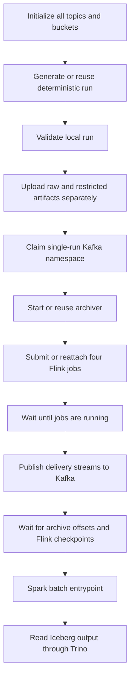

# Whole-pipeline orchestration

This is the compact runbook. Use the [complete usage guide](USER_GUIDE.md) for component commands and troubleshooting, and [what changed and why](IMPLEMENTATION_AND_DECISIONS.md) for the implementation rationale and verification record.

Compose starts long-running infrastructure processes. Airflow owns the pipeline's execution order, source generation/validation, raw publication, archiver startup, Flink submissions, Kafka publication, archive/stream progress checks, Spark execution and Trino validation. Airflow's scheduler is the only service with access to the Docker socket; use this local setup on a trusted development machine.



`egypt_water_pipeline` is manually triggered, has one active run, and defaults to the small smoke dataset. Automatically regenerating and replaying the same fixed historical dataset every day would produce misleading streaming results, so it is deliberately not scheduled. `egypt_water_health` runs every five minutes after you unpause it; it checks managed Flink jobs, the archiver, MinIO state and Trino. Its failures appear in Airflow; no external notification service is configured.

The archiver and Flink jobs remain running between DAG runs. A successful DAG means the source was validated and published, consumer groups reached their upstream offsets, every managed Flink job completed at least one checkpoint, the Spark entrypoint succeeded, and its smoke evidence was queryable in Trino. Streaming Kafka windows remain event-time driven: the final open window of a finite replay may not close without later events. An empty alert topic can be correct. The DAG does not require an alert to exist or claim detection accuracy.

## Start and inspect

Run `scripts/start-pipeline.sh` or `scripts/start-pipeline.ps1` from the repository checkout. Both scripts build the runtime images, start the shared services, create the archiver container for Airflow to start, migrate the Airflow database, and start its scheduler/webserver. The databases and state use named volumes. Services wait for database initialization; pipeline tasks have bounded execution timeouts and sensors release worker slots between polls.

The default credentials, host ports, raw layout and teammate entrypoints are recorded in [AMR_ABDEL_MONEM_HANDOFF.md](AMR_ABDEL_MONEM_HANDOFF.md).

Each Compose service carries an `ewi.network` label matching the resolved network name. This makes network-name changes part of the service configuration so Compose recreates older containers rather than reusing a stale `HostConfig.NetworkMode` (for example, `ewi-net`). A normal startup preserves the data volumes. Stopped containers from an older service layout may still appear as orphans; the startup script leaves them in place. The archiver is prepared with `docker compose up --no-deps --no-start archiver`; `docker compose create` does not support `--no-deps`.

Useful checks:

```bash
docker compose --profile pipeline ps -a
docker compose logs --tail 100 airflow-scheduler archiver flink-jobmanager flink-taskmanager trino
docker compose exec airflow-scheduler airflow dags list-import-errors
docker compose exec airflow-scheduler airflow dags list
docker compose exec trino trino --execute 'SELECT * FROM water.handoff.pipeline_runs'
```

The DAG code is mounted from `orchestration/dags/`. It does no network I/O while parsing. Generator and Spark code is copied into their images; rebuild the corresponding image after editing it. Task containers stream their logs to Airflow, propagate nonzero exit status and are removed on completion or normal task cancellation. A hard scheduler/container kill can leave an orphan task container; inspect containers labeled `ewi.managed=airflow-task` before manually retrying.

## Retry and recovery behavior

- **Initialization:** creates only missing topics/buckets. Repeated initialization does not reset Kafka or delete objects.
- **Generation:** uses the generator's config-derived ID and a filesystem lock. A completed run is reused and validated next. An incomplete run fails explicitly; inspect it and move its directory aside before trying again. The selected config is `smoke` or `pilot`.
- **Raw upload:** checks for required local files and uploads a completion marker last. Paths are stable for a run, so successful uploads can be repeated. Do not mutate a completed source run in place.
- **Streaming ownership:** `water-events/orchestration/stream.json` records the generated dataset and publication state. Existing Kafka data without this registry, a different run ID, or an interrupted publication blocks automatic replay. This is necessary because current downstream Flink tables omit `run_id` and have finite deduplication state TTLs.
- **Flink submissions:** use stable names `ewi-validation`, `ewi-features`, `ewi-alerts`, and `ewi-level_shift`. A task retry reattaches to a running job. A terminated historical job requires explicit recovery. The orchestration never cancels unrelated jobs or deletes downstream topics. Restore a savepoint with the same pipeline name and consumer group before clearing the failed task.
- **Kafka publication:** writes `publishing` before sending and `published` plus offset targets after successful delivery. A subsequent DAG run skips a completed publication. An interrupted attempt cannot be assumed safe to repeat and has no automatic task retry. Inspect offsets and archived objects before recovery; the cleanest new experiment uses a separate Compose project.
- **Progress sensor:** compares archive and Flink group commits against upstream end offsets. The archiver commits only after MinIO uploads; Flink commits occur at checkpoints. A stopped archiver, failed job, or timeout fails the task. It does not use fixed sleeps or a nonempty alert topic as proof of success.
- **Spark smoke:** replaces only the selected run's evidence row. Spark and Trino read-back checks compare actual raw delivery counts with the manifest. Amr AbdEl-Monem's transformation entrypoints must define their own safe run-scoped write behavior and verification.

A scheduler restart preserves Airflow metadata, generator output, Kafka logs, catalog metadata and MinIO objects. Flink's existing configuration persists checkpoint/savepoint files but does not implement automatic job recovery after total cluster loss. Keep this distinction in mind: persistent checkpoint files alone do not automatically resubmit the jobs.

To save streaming state before shutdown, use the existing explicit command:

```bash
./flink/scripts/stop_all.sh
# This existing script stops ALL running jobs; inspect the Flink UI first.
docker compose --profile pipeline down
```

Savepoint paths are logged to `flink/scripts/savepoints.log`. After restarting services, restore each intended job using its saved path, original Python script, stable pipeline name, parallelism one and `--group-id ewi-<key>`. For example:

```bash
docker compose exec flink-jobmanager /opt/flink/bin/flink run -d -p 1 \
  -Dpipeline.name=ewi-validation -s file:///opt/flink/state/savepoints/<saved-path> \
  -py /opt/flink/jobs/job2_district_validation.py --group-id ewi-validation
```

The other keys/scripts are in `runtime.JOBS`. Do not clear the stream registry or restart a job from empty state against populated downstream topics merely to make the DAG green.

An ordinary `down` preserves named volumes. `down -v` deletes Kafka, MinIO, Iceberg catalog metadata, Airflow metadata and Airflow-generated datasets for that project. It is not a routine retry command. For an isolated new experiment, stop the old stack and change `COMPOSE_PROJECT_NAME` before starting the new stack. This preserves the previous project's volumes. Host port mappings remain shared, so the two default stacks cannot run simultaneously without changing ports.

## Local verification and runtime acceptance

The repository test suite covers DAG parsing/dependencies, idempotent initialization, guarded replay, reattachment, task failure cleanup, Trino protocol errors and archive contracts. For local tests, use Python 3.11/3.12 and `python -m pip install -r requirements-dev.txt` in a virtual environment. The Airflow image can also run its CLI DAG import checks. Generator tests additionally exercise the simulation dependencies.

```bash
python -m pytest tests
# Existing generator tests resolve configs relative to Generator/:
cd Generator
python -m pytest tests
cd ..
bash -n scripts/start-pipeline.sh
docker compose --profile pipeline config --quiet
```

Before handoff acceptance on a Docker-enabled machine:

1. Start a fresh project and check `airflow dags list-import-errors` is empty.
2. Trigger the smoke pipeline. Confirm each stage succeeds and Trino returns one row with 360 district records and 48 meter records.
3. Trigger it again. Confirm publication is skipped, exactly four managed Flink jobs exist, and the Iceberg evidence table still has one row for the run.
4. Stop the archiver and trigger the health DAG. Confirm it reports failure; restart through the pipeline task.
5. Verify that selecting `pilot` in this same project fails the namespace guard. Use a separate project for the pilot.

Validation performed: real Airflow 2.10.5 DAG loading, repository and existing generator tests, merged Compose v2 configuration validation, shell syntax, Python compilation, and an actual EPANET smoke generation (360 district records / 48 meter records). After Docker became accessible, the generator, Flink JobManager, Airflow and Spark images all built successfully. Spark uses a Python-compatible MinIO pin; its batch CLI and bundled Python Pi example completed as the normal runtime user. An isolated container also passed Iceberg write/read-back/repeated-overwrite checks using a temporary local warehouse and loaded the bundled S3 and PostgreSQL drivers. Shared services subsequently started successfully with the network migration fix; Airflow's database and scheduler reported healthy, DAG imports were clear, and Docker access from the scheduler was verified after setting the local socket group. The complete service-to-service pipeline still requires the acceptance run above.

Reference configuration follows the official [Airflow Docker deployment documentation](https://airflow.apache.org/docs/apache-airflow/2.10.5/howto/docker-compose/index.html), [Iceberg Spark configuration](https://iceberg.apache.org/docs/1.7.1/spark-configuration/), [Iceberg JDBC catalog](https://iceberg.apache.org/docs/1.7.1/jdbc/), and Trino's [JDBC catalog](https://trino.io/docs/current/object-storage/metastores.html#jdbc-catalog) and [MinIO/S3 settings](https://trino.io/docs/current/object-storage/file-system-s3.html). The Trino runtime is pinned to 484 to match these documented configuration properties.
